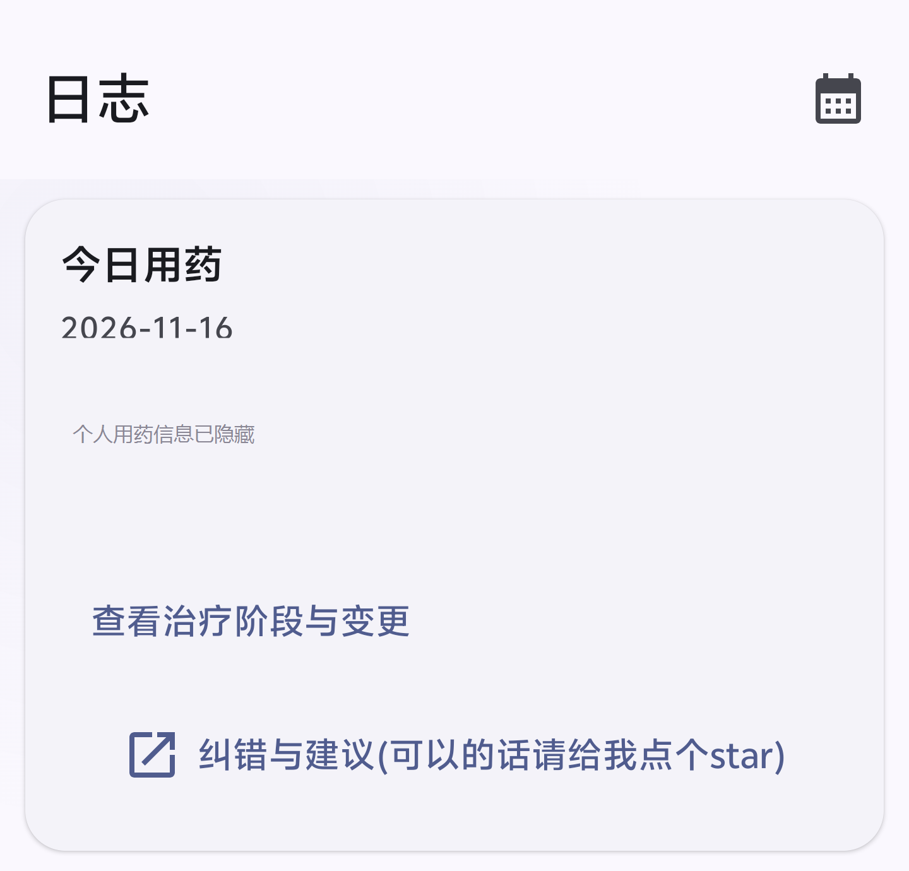
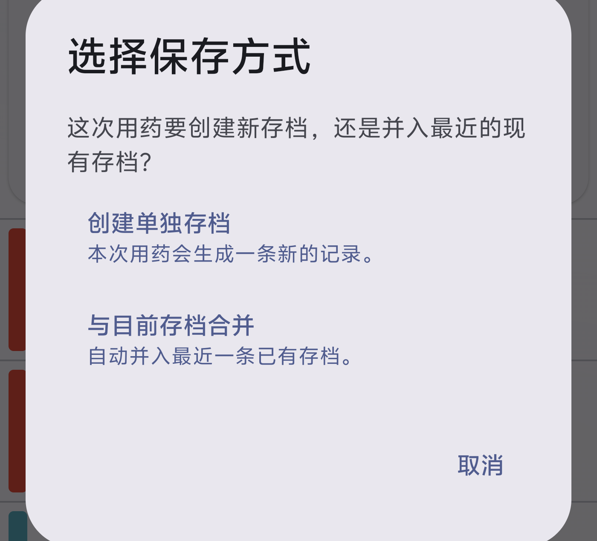
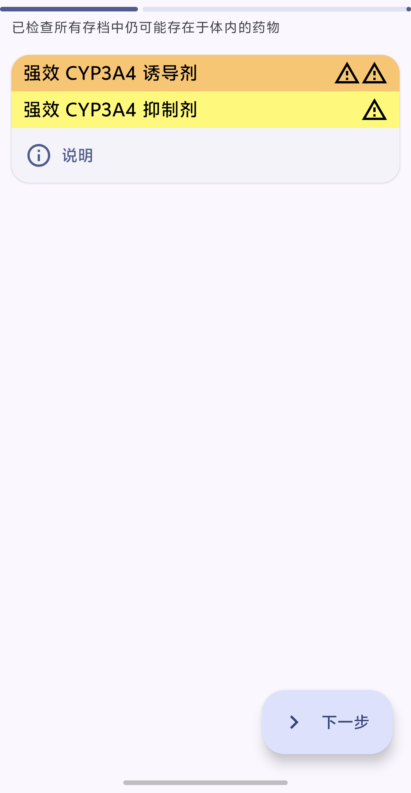
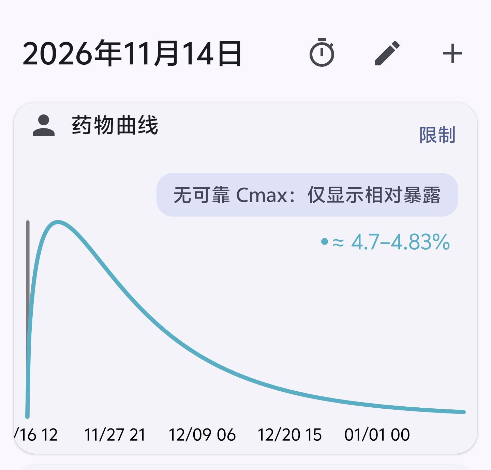
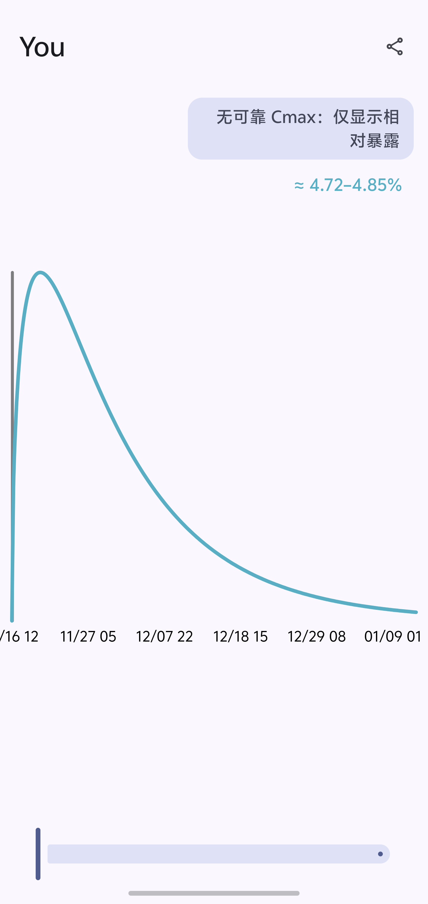

# Journal-HRT 1.2.0

这是一个基于 Journal Android Multilingual 11.9 的 GPLv3 修改版，内置 HRT 常用药物扩展。

## 功能预览

| 今日用药与仓库入口 | 单独存档或合并存档 |
| --- | --- |
|  |  |

| 跨存档相互作用检查 | 血药浓度与多日时间线 |
| --- | --- |
|  |  |

截图使用脱敏测试记录，不包含个人用药信息。

## 安装

- Android 8.0 及以上
- 包名：`io.github.chenyuqing2005.journal`
- 可与原 Journal 同时安装
- 直接安装发布包中的 `Journal-HRT-*.apk`

首次启动会自动安装内置扩展包，无需手动导入。

## 内置扩展

包含 13 个 HRT 相关物质和植入剂：

- 戊酸雌二醇
- 雌二醇舌下片
- 雌二醇凝胶
- 雌二醇贴片
- 醋酸环丙孕酮
- 比卡鲁胺
- 黄体酮
- 醋酸甲羟孕酮
- 地屈孕酮
- 螺内酯
- 戈舍瑞林 3.6 mg 植入剂
- 戈舍瑞林 10.8 mg 植入剂
- 组氨瑞林 50 mg 植入剂

扩展内容包含中文/英文说明、安全使用、不良反应、剂量阈值、化学信息和公开来源。

完整药物、途径、参考 Cmax、Tmax 和半衰期表见 `PHARMACOKINETIC_PARAMETERS.md`。

## 本版功能

- Bateman 一室浓度模型，并用 Tmax 与半衰期反推吸收速率
- 具备完整参数时使用零级、Weibull 或 Higuchi 储库释放模型
- 静脉推注使用峰值后一级消除模型；储库参数缺失时自动回退 Bateman
- 点击右下角加号时先选择“创建单独存档”或“与目前存档合并”
- 相互作用检查跨全部存档，按血药模型识别仍可能存在于体内的药物
- 快速记录、自定义物质和自定义剂量入口同样经过全存档相互作用检查
- 时间线增加按药代模型采样的平滑浓度曲线
- 效果曲线使用不越过参数节点的单调平滑插值
- 血药浓度估算与拖动时间同步
- `pg/mL`、`ng/mL`、`mg/mL`、`mg/L` 单位切换
- 同一种物质的多次给药叠加为一个总估算值
- 支持自定义两段零阶缓释片释放参数
- 多种物质时浓度明细默认收起
- 按单位限制小数位，极低浓度自动隐藏
- 血药浓度阈值通知，默认峰值的 10%，可自定义
- AlarmManager 定时提醒，WorkManager 作为后台兜底
- 新增用药时可选择合并到现有记录或保存为独立记录
- 治疗阶段、暂停、停用及剂量变更历史
- 注射、贴片、植入记录的给药部位、批号和有效期
- “今日用药”摘要和独立桌面小组件
- “今日用药”下方提供项目纠错与建议入口
- 第 1、10、100 次启动时提示使用次数和项目 Star 链接
- 精神科药物来源逐项审计，并使用具体 DailyMed、EMA 或 UK SmPC 页面

## 重要说明

血药浓度是基于公开参考 `Cmax`、`Tmax`、半衰期和制剂释放参数的近似模型，不是个体实测值。剂量线性缩放不能覆盖吸收、首过代谢、制剂、体重、肝肾功能和个体差异。储库参数不完整时会回退 Bateman，不会根据药物名称推测释放参数。

本应用及扩展包不构成医疗建议、诊断、处方或剂量推荐。处方药的使用、调整和停药应遵循专业医疗人员意见。

## 通知

Android 13 及以上需要授予通知权限。部分厂商系统还需要允许自启动、后台运行、通知横幅和精确闹钟；系统“强行停止”应用后，任何 Android 定时方案都会被暂停。

## 许可证与来源

- 上游：Journal Android Multilingual，GPLv3-only
- 修改维护：Chen Yuqing
- 完整许可证见源码中的 `COPYING`
- 源码：https://github.com/Chen-Yu-Qing2005/Journal-HRT

